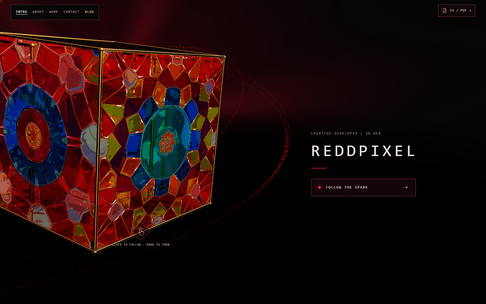

<div align="center">
  
  <h1>REDDPIXEL</h1>
  <p><strong>I build digital and physical systems.</strong></p>
  <p>Interactive web · Procedural art · Technical work</p>
  <p>
    <a href="https://reddpixel.com">Explore the website</a> ·
    <a href="https://reddpixel.com/blog/">Read the journal</a> ·
    <a href="#getting-started">Run locally</a>
  </p>
</div>



REDDPIXEL is a cinematic portfolio built around a stained-glass cube. Persian-inspired geometry, gold details, red particle filaments and a shader-driven inner world connect the visual identity to the work on display.

The experience combines a React interface with an interactive Three.js scene, an English-language technical journal, and a private Content Studio for publishing articles, managing work and moderating comments. Readable HTML remains available when JavaScript or WebGL cannot start.

## The experience

| Destination | What happens |
| --- | --- |
| **Intro** | A glass cube with gold edges, an aura and flowing particles. Drag or swipe to turn it; choose **Follow the spark** to continue. |
| **About** | The camera follows the particles to their source. A red node draws the frame around the profile, skills, experience and credentials while the cube leaves the view. |
| **Work** | The camera returns to the cube and passes through it before revealing the inner world. Browse **Websites**, **Visuals** and **Technical work**, with carousels and full-screen image galleries. |
| **Contact** | The Oracle chat and direct contact links. English is the default; Persian and German messages select their corresponding response language. |
| **Journal** | Dedicated article URLs, readable HTML, Persian-inspired artwork and moderated visitor comments. |
| **Content Studio** | Single-owner editing for articles, work collections and media, with draft previews and comment approval/replies. |

The four portfolio phases support direct bookmarks (`/#intro`, `/#about`, `/#work`, `/#contact`) and browser Back/Forward navigation.

## Built with

| Layer | Tools |
| --- | --- |
| Interface | React 19, TypeScript, Tailwind CSS 4 |
| Scene | Three.js, React Three Fiber, Drei, custom GLSL shaders |
| Motion | GSAP, scoped UI timelines and camera choreography |
| State | Zustand for experience state; mutable scene values for frame updates |
| Build | Vite 8, TypeScript, ESLint |
| Backend | Cloudflare Pages Functions and D1 |
| Oracle | Server-side Groq integration with repository-backed portfolio context |

## Getting started

Use **Node.js 22.16 or later in the 22.x series** and **npm 10**.

```bash
git clone https://github.com/R3dPixelStudio/reddpixel.git
cd reddpixel
npm ci
npm run dev
```

Open the URL printed by Vite, normally `http://localhost:5173`. On Windows, use `npm.cmd` if PowerShell blocks `npm`.

Vite runs the frontend and repository-backed journal. For authentication, database content, uploads, comments and the Oracle API, use the Cloudflare Pages preview below.

### Local Content Studio

From the repository root:

```bash
npm run cms:password
npm run cms:migrate:local
npm run cms:preview
```

Choose a password with at least 16 characters in your own terminal. The password helper writes a salted hash to the ignored `.dev.vars` file; terminal input is visible. Open `http://127.0.0.1:8788/admin/` and sign in with the password you chose.

Local D1 data persists under `.wrangler/state/`. It is separate from production data. Restart the preview after changing secrets.

### Configuration

| Name | Type | Purpose |
| --- | --- | --- |
| `CMS_DB` | D1 binding | Articles, work entries, comments, sessions and uploaded media. |
| `ADMIN_PASSWORD_HASH` | Secret | Salted hash generated by `npm run cms:password`; required for the studio. |
| `GROQ_API_KEY` | Secret | Enables provider-backed Oracle replies. |
| `ALLOWED_ORIGIN` | Optional variable | Oracle request origin, such as `https://reddpixel.com`. Defaults to the request's origin. |

Keep local secrets in `.dev.vars` and production secrets in Cloudflare. Never commit passwords, password hashes or API keys. Without CMS configuration, repository content still renders and the studio displays setup instructions.

**New uploads use D1. R2 and a `CMS_MEDIA` binding are not required.** An existing R2 binding is used only to read legacy media.

## Editing content

**Through the studio:** open `/admin/` to create or edit articles and work, upload or replace media, preview saved drafts, and approve or reply to comments. Publishing updates server-rendered content without a frontend rebuild. Database entries override matching repository entries.

**Through the source:** use these files, then rebuild and deploy:

| File or folder | Edit here |
| --- | --- |
| [`src/content/portfolio.ts`](src/content/portfolio.ts) | Profile, expertise, contact destinations and starting work collections. |
| [`src/content/journal.ts`](src/content/journal.ts) | Repository-backed articles. |
| [`public/images/`](public/images/) | Static portfolio images and media; paths begin with `/images/` in the website. |
| [`public/cv/`](public/cv/) | Add the owner-authored PDF as `arash-mohammadi.pdf` to enable CV viewing/downloading. |
| [`src/world/introComposition.ts`](src/world/introComposition.ts) | Desktop and mobile intro camera composition. |
| [`src/world/aboutComposition.ts`](src/world/aboutComposition.ts) | About camera pose and particle-source alignment bounds. |

Studio uploads accept JPEG, PNG and WebP images up to **8 MiB**, and MP4/WebM video up to **20 MiB**, within a **300 MiB** application media budget. Compress photos and timelapses before uploading. Uploaded media URLs are public; unpublished draft text requires authentication.

See [Content Studio documentation](docs/CMS.md) for the article format, gallery editing, moderation and production setup.

## How the scene works

GSAP animates camera and scene values in `worldState`. `TimelineBridge` applies those values to the Three.js camera each frame, while Zustand coordinates the current phase, transition locks and UI visibility. Camera motion does not require React state updates on every frame.

The About particle source is projected from the DOM frame into world space, keeping the emitter aligned with the red corner node across viewport changes. The inner-world shader stays hidden until the camera passes beyond the cube.

Rendering quality follows GPU capability. The scene caps pixel density, provides a conservative cube renderer, supports reduced motion, and pauses rendering when the page is hidden or the scene is obscured. Event listeners, observers, timers and animation timelines clean up with their owning components. Real-device performance still needs testing when scene complexity or media changes.

```text
src/
  world/           Cube, lighting, shaders, particles and interaction
  core/timeline/   Camera controller and render-frame bridge
  stores/          Experience state
  ui/              Phase panels, navigation and media carousels
  content/         Portfolio, journal and content types
  journal/         Journal client and artwork
  admin/           Content Studio and upload interface
functions/         Pages routes: Oracle, CMS, media, HTML and sitemap
server/            Database helpers, authentication and media storage
migrations/        D1 schema migrations
scripts/           HTML generation, verification and local tooling
public/            Static media, styles, headers and robots.txt
docs/              Setup, implementation and editorial guides
```

## Checks

```bash
npm run build
npm run lint
npm run check:seo
npm run test:navigation
npm run test:cube
npm run test:oracle
npm run test:content
npm run test:security
```

`build` type-checks the project and produces `dist/`. The checks cover generated HTML/SEO, navigation lifecycle, cube interaction, Oracle input handling, content validation, and authentication/media helpers.

`npm run test:cms` is a separate integration check that creates temporary content in a **local Pages preview**. Follow the isolated-fixture instructions in [docs/CMS.md](docs/CMS.md#verification); it is not part of the ordinary frontend setup.

## Deploying to Cloudflare Pages

The existing project uses GitHub-connected Pages deployments:

| Setting | Value |
| --- | --- |
| Repository | `R3dPixelStudio/reddpixel` |
| Production branch | `main` |
| Build command | `npm run build` |
| Output directory | `dist` |

1. Push a change branch and review its Cloudflare preview when branch previews are enabled.
2. For the studio, bind the production D1 database as `CMS_DB`, apply the migrations, and set `ADMIN_PASSWORD_HASH`. Configure the Oracle key separately.
3. Merge into `main` to trigger production deployment. Confirm the Cloudflare build succeeds before treating the update as live.
4. Check direct phase bookmarks, galleries, the journal, `/sitemap.xml` and any changed backend features on the deployed domain.

The checked-in `wrangler.jsonc` contains a **local database placeholder**, not production bindings. It deliberately omits `pages_build_output_dir`; live settings remain managed in the Pages dashboard. Configure production and preview bindings/secrets separately, and redeploy after changing them.

Commit `package.json` and `package-lock.json` together after dependency changes. Use `npm ci` to verify a clean install.

## Further reading

- [Implementation notes](docs/IMPLEMENTATION.md) — scene, UI and navigation decisions.
- [Content Studio](docs/CMS.md) — editing, uploads, moderation and authentication.
- [Deployment](docs/DEPLOYMENT.md) — preview and production workflow.
- [SEO checklist](docs/SEO-CHECKLIST.md) — indexing and original-content tasks.
- [Promotion routine](docs/PROMOTION.md) — a practical publishing schedule.

---

<div align="center">
  <strong>Follow the spark.</strong><br />
  <a href="https://reddpixel.com">reddpixel.com</a>
</div>
